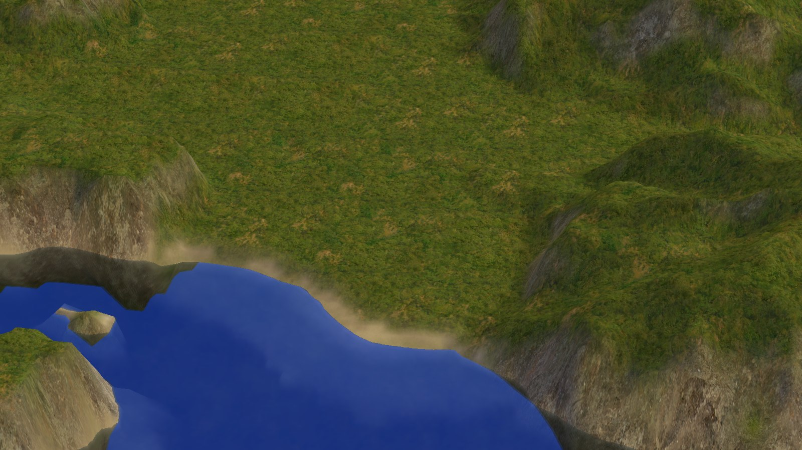
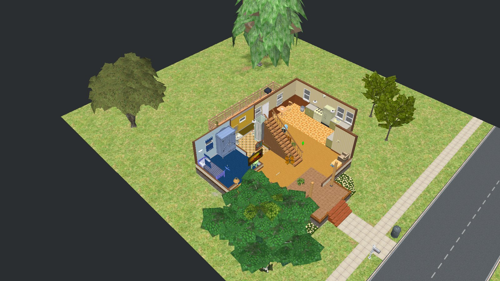

# NeoTS2

**A new, open, 64-bit engine for The Sims 2.**

NeoTS2 runs The Sims 2 on a modern, open codebase. It reads the game's own files from your
installation (neighborhoods, lots, objects, Sims, scripts, 3D assets and the user interface) and
rebuilds the game on top of them: the simulation that drives objects and Sims, the houses and
neighborhoods in 3D, and the game's screens.

> **You need your own copy of The Sims 2** (the Ultimate Collection or the base game with its
> packs). NeoTS2 contains none of the game's files and never will.

## Why

The Sims 2 engine is twenty years old: a 32-bit, fixed-function program tied to old hardware and
closed to deeper modding. NeoTS2 aims to keep everything that makes the game what it is while
giving it:

- **a native 64-bit (x64) engine** that uses modern graphics APIs (Direct3D 12 today) and the
  memory a modern PC has;
- **an engine you can read and change**;
- **modern graphics as an option**: the classic look by default, with room for improved
  lighting, shadows and effects as mods;
- **modding without limits**: new behavior, new rendering, new tools, built on code rather
  than workarounds.

The classic look is rebuilt from how the original game works, not approximated: where the game
computes something (terrain paint, lighting, camera framing), NeoTS2 does the same computation.

## What works today

NeoTS2 is in early development. It isn't playable yet, but you can already look around:

- **Main menu:** the game's neighborhood chooser, built from its own UI scripts, fonts and
  images, with the neighborhood videos, previews, buttons and tooltips.
- **Neighborhoods:** the terrain with the game's paints, lighting and shadows, and its
  reflective water, seen through the game's neighborhood camera.
- **Lots:** a saved lot in 3D: walls with doors and windows, floors, roofs, fences and objects,
  with walls up, cutaway or down.
- **Game files:** the game's packages and most of its resource formats: objects, string tables,
  behavior scripts, 3D models and textures, saved neighborhoods, families, lots and Sims.
- **Simulation:** object behavior (SimAntics, and the Lua scripts the expansions use) running
  against a saved lot, with a growing set of the game's primitives.

| Main menu | Neighborhood | Lot |
| --- | --- | --- |
|  |  |  |

*Screenshots of NeoTS2 running on the game's own files.*

## Tools and libraries

| What | Used for |
| --- | --- |
| C++20, CMake 3.20+ | the language and the build |
| Visual Studio 2022 (MSVC), x64 | the compiler on Windows; NeoTS2 is built and tested as 64-bit |
| [SDL 3](https://www.libsdl.org/) | the window, input and GPU access (Direct3D 12) |
| DXC, from the Windows SDK | compiling the HLSL shaders |
| [FreeType](https://freetype.org/) 2.13 | drawing the game's fonts |
| [stb_image](https://github.com/nothings/stb) 2.30 (included) | reading PNG, JPEG and BMP images |
| [Lua](https://www.lua.org/) 5.0.3 (included) | the scripting language the game's expansions use |

## Building

You need CMake 3.20+, Visual Studio 2022 with the C++ workload and the Windows SDK, the
[SDL 3](https://github.com/libsdl-org/SDL/releases) development package for Visual Studio, and
FreeType 2.13 built with CMake. Then:

```
cmake -S . -B build -A x64 -DSDL3_DIR=<SDL3>/cmake -Dfreetype_DIR=<FreeType install>/lib/cmake/freetype
cmake --build build --config Release
```

Without SDL 3 or DXC, the libraries, tools and tests still build; the `neots2` app is skipped.

## Running

```
neots2 "<The Sims 2 install folder>" --menu --user "<your Sims 2 user folder>"
neots2 "<The Sims 2 install folder>" "<user folder>/Neighborhoods/N001"
neots2 "<The Sims 2 install folder>" "<user folder>/Neighborhoods/N001/Lots/N001_Lot1.package"
```

The first opens the main menu, the second a neighborhood, the third a lot. In 3D views: drag
with the left mouse button to turn, with the right to move, and use the wheel to zoom; on lots,
Page Up/Down change storey, 1/2/3 show walls up, cutaway or down, and R turns roofs on and off.

## Contributing

Contributions are welcome. Please read [CONTRIBUTING.md](CONTRIBUTING.md) first. In short:

- no game files, and nothing exported from them;
- no code taken from the game or from projects whose license doesn't allow it.

## Disclaimer

NeoTS2 is an independent fan project. It is not affiliated with, endorsed by or connected to
Electronic Arts or Maxis. The Sims is a trademark of Electronic Arts Inc.

Portions of this software are copyright © 2024 The FreeType Project (www.freetype.org). All
rights reserved.

## License

NeoTS2 is free to use, change, copy and share, and to build on: fork it, make mods and tools for
it, use its code in your own projects. Mods, add-ons, content and tools made for NeoTS2 are yours,
and you may sell them. The one thing you may not do is sell NeoTS2 itself, or a product or service
that is essentially NeoTS2.

[MIT with the Commons Clause](LICENSE)
