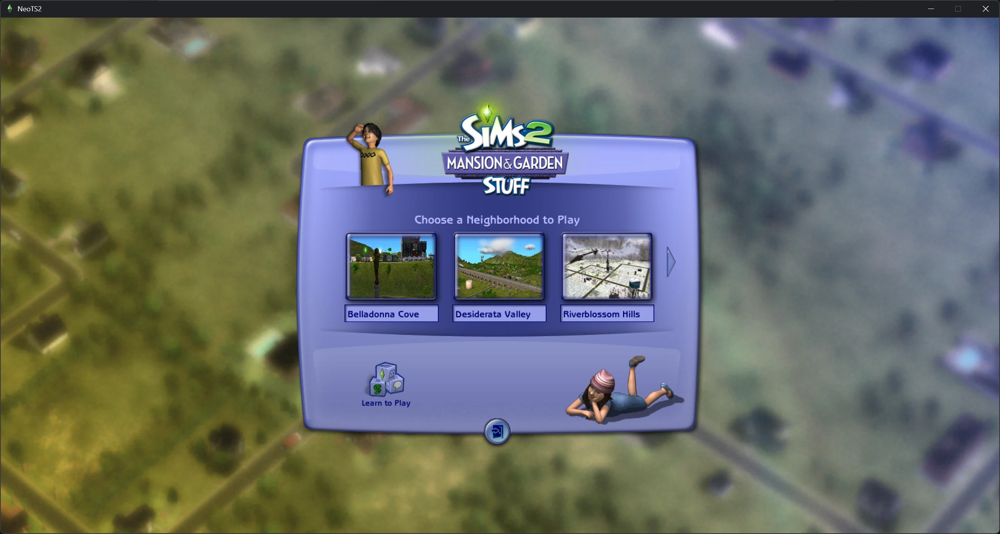
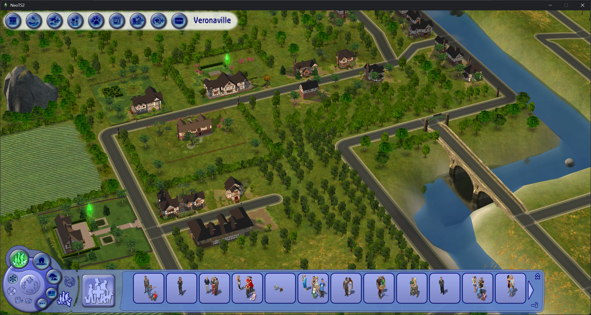
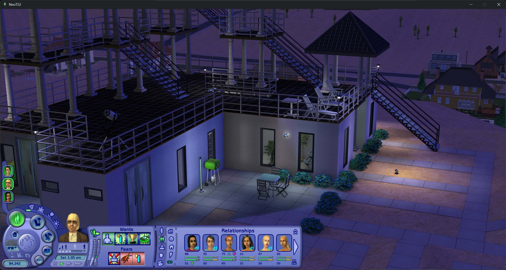
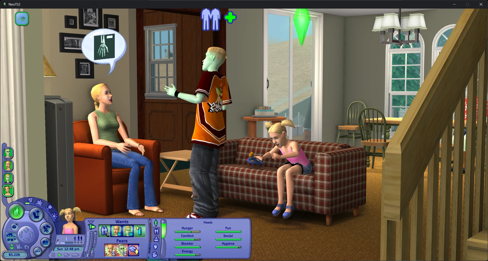

<h1> NeoTS2</h1>

**A new, open-source, 64-bit engine for The Sims 2.**

[](https://github.com/Asli-s/NeoTS2/releases)

NeoTS2 is a reimplementation of the Sims 2 engine. It loads the game data from your existing
installation and runs it on new code.

> **You need your own copy of The Sims 2** (Ultimate Collection, Legacy Collection, or the base
> game with its packs). NeoTS2 does not include any game files.

## Goals

- Run natively as a 64-bit application on Direct3D 12, Metal or Vulkan
- Improve performance and eliminate crashes
- Match the original game's look and behavior by default
- Offer improvements as optional settings
- Make deeper modding possible through open code

## Status

NeoTS2 is in early development and is not yet a complete engine. Currently working:

- Launcher, main menu and neighborhood chooser
- Neighborhoods with terrain, water, lighting, effects and lot imposters
- Lots with walls, floors, roofs and objects, in day and night lighting
- Live mode camera, panels, needs and wants
- Sims on their lots (behavior is still early and buggy)
- Custom content from the Downloads folder
- Sound effects, Sims' voices and the menu and neighborhood music
- Buy mode, first stage: browse the catalog by function or room, buy and place objects on the floor (beds and sofas too), on counters and tables, and against walls; move and sell them
- Build mode, first stages: lay and take up floor tiles, cover walls (one side, or a whole room), build and take down straight walls, put in doors, windows and arches, and paint the terrain; the sledgehammer, and undo and redo in Buy and Build mode; the other tools are not built yet

Saving is not supported yet.

| Main menu | Neighborhood |
| :---: | :---: |
|  |  |
| **Lot** | **Sims** |
|  |  |

## Getting started

1. Back up your save folder in Documents\EA Games, or create a new one from the launcher.
2. Download the latest release from the [Releases page](https://github.com/Asli-s/NeoTS2/releases):
   - **Windows:** extract the zip and run `neots2-launcher.exe`.
   - **macOS (Apple Silicon):** move `NeoTS2.app` to Applications and open it.
   - **Linux (x86_64):** extract the archive and run `./neots2-launcher`. A Vulkan driver is required.
3. Select your game installation and save folder, then click **Play**.

The macOS and Linux builds are new and have had little testing. Bug reports are welcome.

NeoTS2 is not code-signed yet. On Windows, click **More info** and then **Run anyway**. On macOS,
Control-click the app and choose **Open**.

NeoTS2 does not modify save folders that already contain files. It only sets up new or empty
folders, and asks before adding the default neighborhoods.

## Crash reports

When NeoTS2 crashes, it writes `crash.txt` and `neots2.dmp` to its `logs` folder (or
`%LOCALAPPDATA%\NeoTS2\logs`). Nothing is uploaded unless you click **Send a report**. Reports go to
[BugSplat](https://www.bugsplat.com), are kept for one month, and are used only to fix crashes.
The dump file may contain folder names from your computer.

## Building

On Windows with Visual Studio 2022:

```
cmake -S . -B build -A x64 -DSDL3_DIR=<SDL3>/cmake -Dfreetype_DIR=<FreeType>/lib/cmake/freetype
cmake --build build --config Release
```

See [BUILDING.md](BUILDING.md) for requirements, macOS, Linux and the OpenGL 2 renderer.

## How NeoTS2 is made

Much of the code is written together with AI, and I direct the work. File formats and behavior come 
from studying the game itself, but only tested cases are verified. If you use NeoTS2 as a reference 
for the game's file formats, verify anything important against the game.

## Credits

- [SimPE](https://sourceforge.net/projects/simpe/) was used as a reference. None of its code is used.
- The AI has likely learned from public community work such as
  [OpenTS2](https://github.com/LazyDuchess/OpenTS2). None of OpenTS2's code is used.
- [kouta-kun](https://github.com/kouta-kun): Linux build, Vulkan support, OpenGL 2 renderer and Mac
  OS X PowerPC port
- [VHSMODDING](https://github.com/VHSMODDING): native macOS build for Apple Silicon
- Libraries: [SDL 3](https://www.libsdl.org/), [FreeType](https://freetype.org/),
  [stb_image and stb_dxt](https://github.com/nothings/stb), [Lua](https://www.lua.org/) 5.0.3,
  [Speex](https://www.speex.org/) 1.2.1, [dr_mp3](https://github.com/mackron/dr_libs),
  [Dear ImGui](https://github.com/ocornut/imgui) (MIT) and the
  [Noto Sans](https://fonts.google.com/noto/specimen/Noto+Sans) font (SIL Open Font License 1.1)
- App and launcher icons drawn by me

## Contributing

Please read [CONTRIBUTING.md](CONTRIBUTING.md) first. Do not submit game files, anything exported
from them, or code you don't have the right to share.

## License

NeoTS2 is licensed under [MIT with the Commons Clause](LICENSE). You can use, modify and share it,
and build mods, tools and other projects on it. You may sell what you make for NeoTS2, but not
NeoTS2 itself or a product that is essentially NeoTS2.

NeoTS2 is an independent fan project and is not affiliated with or endorsed by Electronic Arts or
Maxis. The Sims and the plumbob are trademarks of Electronic Arts Inc. Portions of this software are
copyright © 2024 The FreeType Project (www.freetype.org). All rights reserved.
