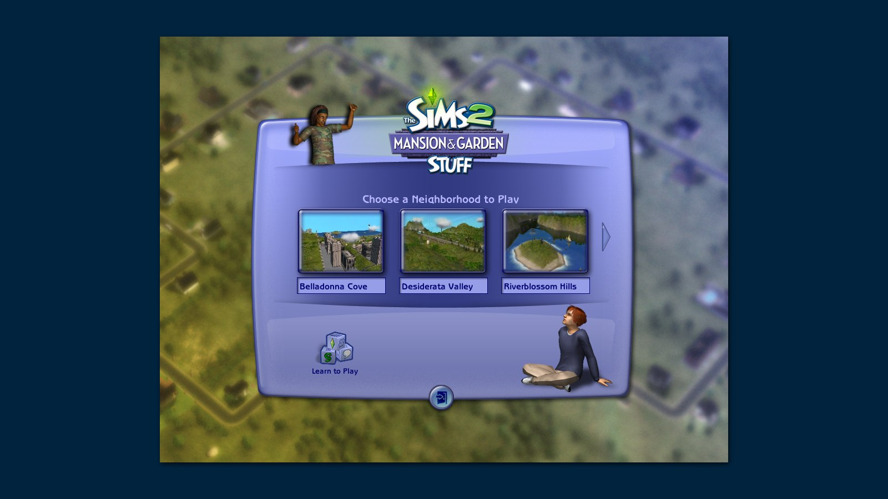
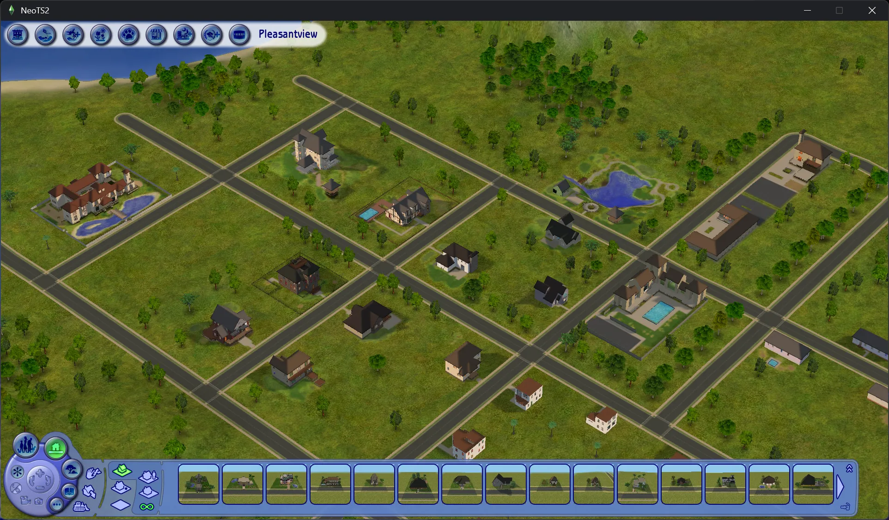
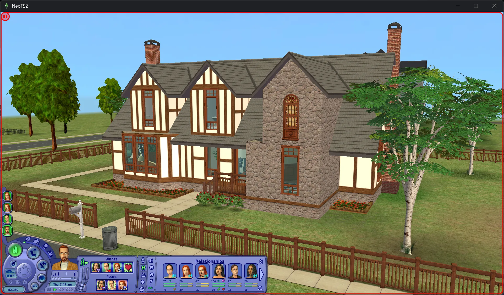
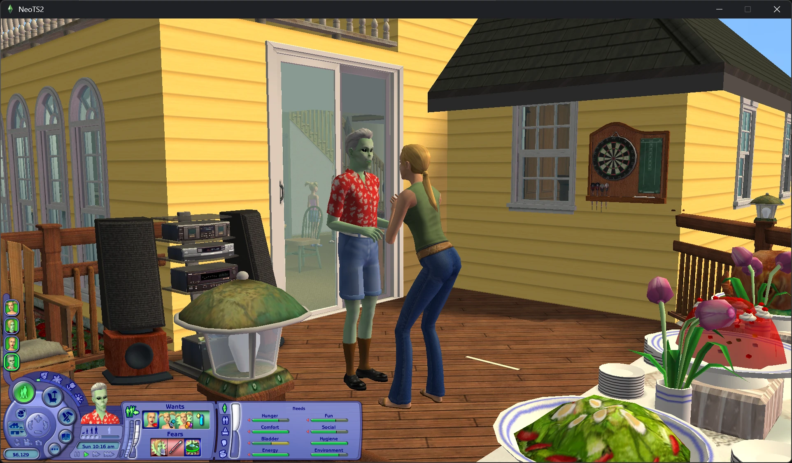

<h1> NeoTS2</h1>

**A new, open, 64-bit engine for The Sims 2.**

NeoTS2 runs The Sims 2 on a modern, open codebase. It reads the game's own files from your
installation (neighborhoods, lots, objects, Sims, scripts, 3D assets and the user interface) and
rebuilds the game on top of them: the simulation that drives objects and Sims, the houses and
neighborhoods in 3D, and the game's screens.

> **You need your own copy of The Sims 2** (the Ultimate Collection or the base game with its
> packs). NeoTS2 contains none of the game's files and never will.

## Why

The Sims 2 engine is twenty years old: a 32-bit, fixed-function program tied to old hardware and
closed to deeper modding. NeoTS2 aims to keep everything that makes the game what it is while
giving it:

- **a native 64-bit engine** that uses modern graphics APIs (Direct3D 12 on Windows, Metal on
  macOS) and the memory a modern computer has
- **an engine you can read and change**
- **modern graphics as an option**: the classic look by default, with room for improved
  lighting, shadows and effects as mods
- **modding without limits**: new behavior, new rendering, new tools, built on code rather
  than workarounds

The classic look is rebuilt from how the original game works and is not approximated: where the game
computes something (terrain paint, lighting, camera framing), NeoTS2 does the same computation.

## What works today

NeoTS2 is in early development. It isn't a full game yet, but you can already visit your
neighborhoods and lots:

- **Launcher:** finds or lets you choose your Ultimate Collection or Legacy Collection and your
  save folders
- **Main menu:** the game's neighborhood chooser, built from its own UI scripts, fonts and
  images
- **Neighborhoods:** the terrain with the game's paints, lighting and shadows, and its
  reflective water
- **Lots:** walls with doors and windows, floors, roofs, fences and objects, in the game's
  daylight and night lighting, with bump-mapped surfaces
- **Live mode:** the game's camera for lots (drag, scroll, zoom and turn), and its panels: needs,
  mood and aspiration bars
- **Sims:** your Sims are on their lots, but what they do is still very early and buggy
- **Game files:** the game's packages and resource formats: objects, string tables,
  behavior scripts, 3D models and textures, saved neighborhoods, families, lots and Sims

Custom content (your Downloads folder) isn't read yet, so objects, clothes, hair and other
downloads don't show in NeoTS2 for now.

*Screenshots from an unreleased development version of NeoTS2.*

| Main menu | Neighborhood |
| --- | --- |
|  |  |
| **Lot** | **Sims** |
|  |  |

## Your saves

> **Back up your saves before you try NeoTS2.** It is early, unfinished software. Copy your save
> folder (in Documents\EA Games, for example The Sims™ 2 Ultimate Collection) somewhere safe first, or
> make a new save folder for NeoTS2 with the launcher's **New save folder...**.

NeoTS2 doesn't save games yet, and when it starts with a save folder:

- a folder that already has anything in it is loaded as it is, and nothing is added or changed
- only a missing or empty folder is set up, and the copy is made beside it and moved in at the
  end, so a crash or power cut part way leaves the folder as it was
- if a save folder has files but no neighborhoods, the launcher asks before adding the ones your
  install ships
- what your install holds is copied as it is, so if you removed the shipped neighborhoods or
  neighborhood templates from your install, they stay removed
- system folders and the game's own install folder are never used as save folders

## Running

**Back up your saves first** (see [Your saves](#your-saves)).

On Windows, download the newest release from the [Releases page](https://github.com/Asli-s/NeoTS2/releases),
extract the whole zip, and start **`neots2-launcher.exe`**. On an Apple Silicon Mac, download the
`macos-arm64` zip, move **NeoTS2.app** somewhere permanent (such as Applications), and open it.
The launcher finds your install and your save folders. Choose them, or make a new save folder with
**New save folder...**, and press **Play**.

Windows may say "Windows protected your PC", because NeoTS2 isn't signed yet. Click **More info**,
then **Run anyway**.

macOS may say it cannot verify NeoTS2 because it isn't signed or notarized yet. Control-click the
app, choose **Open**, then choose **Open** again.

## Tools and libraries

| What | Used for |
| --- | --- |
| C++20, CMake 3.20+ | the language and the build |
| Visual Studio 2022 (MSVC), x64 | the compiler on Windows; NeoTS2 is built and tested as 64-bit |
| [SDL 3](https://www.libsdl.org/) | the window, input and GPU access (Direct3D 12) |
| DXC, from the Windows SDK | compiling the HLSL shaders |
| [FreeType](https://freetype.org/) 2.13 | drawing the game's fonts |
| [stb_image](https://github.com/nothings/stb) 2.30 (included) | reading PNG, JPEG and BMP images |
| [Lua](https://www.lua.org/) 5.0.3 (included) | the scripting language the game's expansions use |

## Building

You need CMake 3.20+, Visual Studio 2022 with the C++ workload and the Windows SDK, the
[SDL 3](https://github.com/libsdl-org/SDL/releases) development package for Visual Studio, and
FreeType 2.13 built with CMake. Then:

```
cmake -S . -B build -A x64 -DSDL3_DIR=<SDL3>/cmake -Dfreetype_DIR=<FreeType install>/lib/cmake/freetype
cmake --build build --config Release
```

This builds `neots2`. Without SDL 3 or DXC, the libraries, tools and tests still build; the app
is skipped.

### macOS (Apple Silicon)

NeoTS2 can run natively on macOS: it does **not** run the original Windows executable. Instead,
it reads the data files from your own Windows Ultimate Collection installation and renders through
Metal. Copy that installation to the Mac (or make it available on a mounted volume), keeping the
pack folders such as `Double Deluxe` and `Fun with Pets` together.

With [Homebrew](https://brew.sh/), install the build dependencies and make the native arm64 apps:

```
brew install cmake sdl3 shaderc spirv-cross freetype
cmake -S . -B build-macos -DNEOTS2_STRICT=OFF
cmake --build build-macos --target neots2 neots2-launcher --parallel
```

Start `build-macos/neots2-launcher`, choose the copied game folder when asked, then choose or make
a save folder in your Documents directory. The launcher remembers both choices. For a direct start:

```
build-macos/neots2 "<The Sims 2 install folder>" --menu --user "<save folder>"
```

To make the `NeoTS2.app` and `macos-arm64` zip for a release:

```
tools/package_macos.sh build-macos
```

The macOS build uses Shaderc (`glslc`) to compile the project's HLSL shaders to SPIR-V, then
SPIRV-Cross to make the MSL shaders that SDL 3 loads with its Metal backend. DXC's official binary
releases do not provide a macOS executable.

### OpenGL 2 renderer

NeoTS2 draws with SDL's GPU API (Direct3D 12 on Windows, Metal on macOS, Vulkan elsewhere). It can also draw with
OpenGL 2.1, for systems with no more: start it with `--renderer gl2` (the launcher has a Graphics
choice). It is not built unless you ask for it with `-DNEOTS2_GL2=ON`, which needs `spirv-cross` (from the Vulkan SDK
or your package manager; or give `-DNEOTS2_SPIRV_CROSS=<path>`). The launcher offers it only in a build that has it.
If it can't start (a driver below OpenGL 2.1), the game says so and draws with the default renderer.
Its GLSL 1.20 shaders are made from the same HLSL by DXC (built with SPIR-V) and SPIRV-Cross.

The OpenGL 2 renderer draws the same things, some another way: the neighborhood terrain takes a pass
for each paint texture (there are no texture arrays) and Sims are posed on the CPU. The water's reflection
and the pictures drawn off-screen (portraits) need framebuffer objects: without them the reflection is left
out and the pictures are drawn in a corner of the window. Scenes are uploaded on other threads where the
driver lets contexts share objects.

A build from this source starts from the command line:

```
neots2 "<The Sims 2 install folder>" --menu --user "<your Sims 2 user folder>"
neots2 "<The Sims 2 install folder>" "<user folder>/Neighborhoods/N001"
```

The first opens the main menu, the second a neighborhood.

For example, with the Ultimate Collection installed, open a Command Prompt in the folder you 
built into and run:

```
cd build\Release
neots2.exe "C:\Program Files\EA Games\The Sims 2 Ultimate Collection" --menu
```

`--user` can be left out when your user folder is the usual one, in Documents\EA Games\The Sims™ 2
Ultimate Collection. If the game is installed elsewhere, use the folder that holds its "Double
Deluxe", "Fun with Pets" and other pack folders.

## Crash reports

If NeoTS2 crashes, it saves a report in the `logs` folder next to it (or in
`%LOCALAPPDATA%\NeoTS2\logs`). Nothing is sent unless you click **Send a report**.

A report has two files: `crash.txt` (what went wrong) and `neots2.dmp` (a snapshot of the program
when it crashed). In `crash.txt` your user folder is shown as `%USERPROFILE%`; the dump may still
contain folder names from your computer.

**Send a report** uploads only those two files to [BugSplat](https://www.bugsplat.com), which keeps
them for a month. I use them only to fix crashes. You can also open a GitHub issue and attach them
yourself (GitHub issues are public).

## How NeoTS2 is made

Much of the code is written together with AI (Claude), and I direct the work. Formats and
behavior come from studying the game itself, but only the cases we've tested are verified, and
some details are still open. If you use NeoTS2 as a reference for the game's file formats, check
anything important against the game yourself.

## Credits

Thanks to The Sims 2 community: [SimPE](https://sourceforge.net/projects/simpe/) was used as a
reference (none of its code is used). The AI has likely picked up general knowledge, like file
formats and where things are stored, from public community work such as
[OpenTS2](https://github.com/LazyDuchess/OpenTS2). None of OpenTS2's code is used.

Thanks to [kouta-kun](https://github.com/kouta-kun) for the Linux build, the Vulkan path, the
OpenGL 2 renderer and the Mac OS X PowerPC port.

The app and launcher icons are hand-drawn by me.

The launcher uses [Dear ImGui](https://github.com/ocornut/imgui) (MIT) and the
[Noto Sans](https://fonts.google.com/noto/specimen/Noto+Sans) font (SIL Open Font License 1.1).

## Contributing

Please read [CONTRIBUTING.md](CONTRIBUTING.md) first. In short:

- no game files, and nothing exported from them
- no code taken from the game or from projects whose license doesn't allow it

## Disclaimer

NeoTS2 is an independent fan project. It is not affiliated with, endorsed by or connected to
Electronic Arts or Maxis. The Sims and the plumbob are trademarks of Electronic Arts Inc.

Portions of this software are copyright © 2024 The FreeType Project (www.freetype.org). All
rights reserved.

## License

NeoTS2 is free to use, change, copy and share, and to build on: fork it, make mods and tools for
it, use its code in your own projects. Mods, add-ons, content and tools made for NeoTS2 are yours,
and you may sell them. The one thing you may not do is sell NeoTS2 itself, or a product or service
that is essentially NeoTS2.

[MIT with the Commons Clause](LICENSE)
